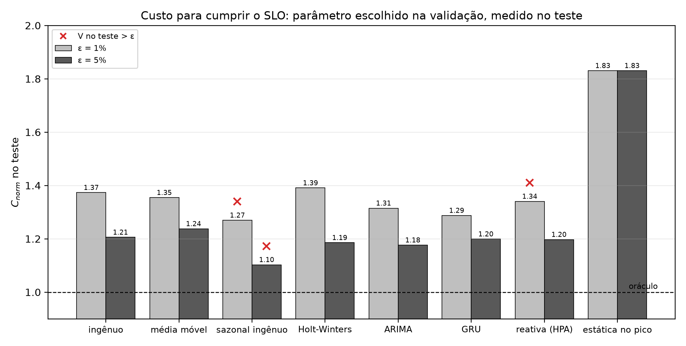
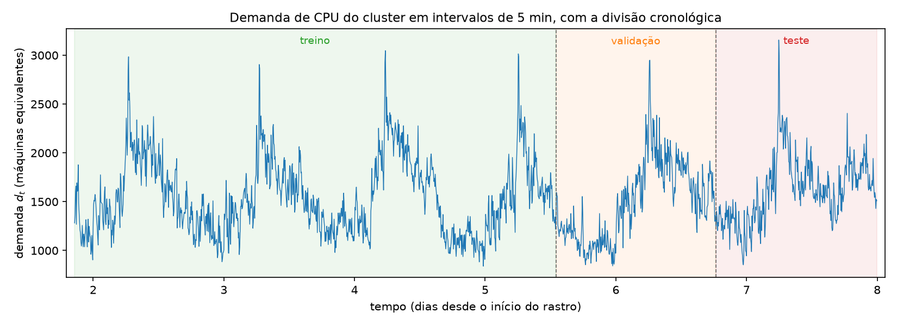
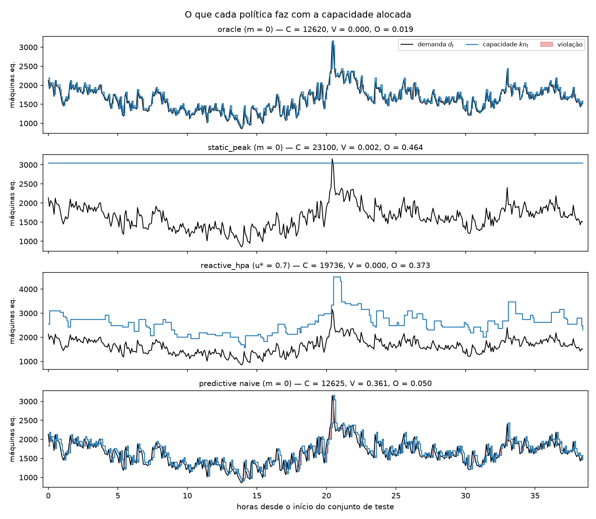
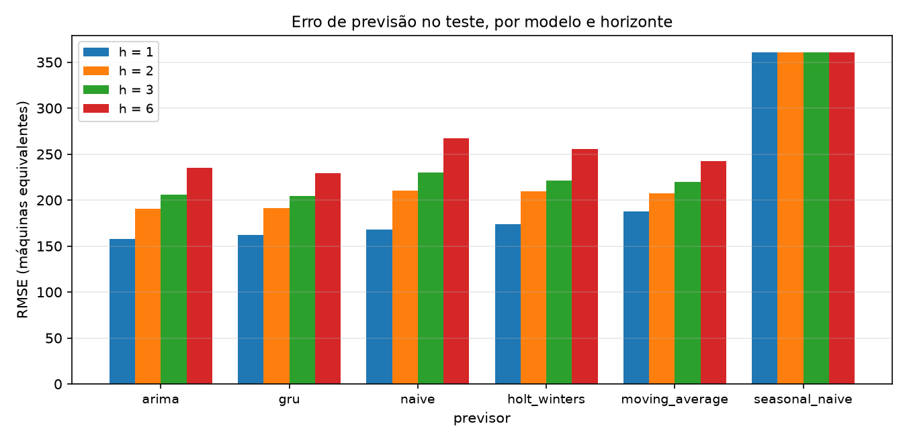

# Alocação preditiva de recursos em nuvem via previsão de carga com Redes Neurais para minimização de custos operacionais


Trabalho de conclusão de curso de Engenharia de Computação, PUC-Rio.

- **Autor:** Gabriel Lobo de Sant Anna Rosas
- **Orientador:** Adriano Francisco Branco
- **Coorientador:** Jonatas dos Santos Grosman

<p align="center">
  
  <br>
  <sub>Custo no teste (1,0 = oráculo) para cumprir o limite de violações ε. Um × vermelho marca as configurações que ultrapassaram ε no teste.</sub>
</p>

## O que é

Um provedor de nuvem precisa decidir, a cada poucos minutos, quantas instâncias manter ativas.
Instâncias demais custam caro; de menos, violam o acordo de nível de serviço (SLA). A alocação
reativa só ajusta depois de ver a demanda mudar, e por isso chega atrasada nos picos. A
alternativa é prever a demanda e provisionar antes.

A pergunta do trabalho é **o quanto a qualidade da previsão de carga reduz o custo de alocação
sem aumentar as violações de SLA**, comparando redes neurais com métodos tradicionais. Para que as
diferenças possam ser atribuídas à previsão, **a política de alocação é fixa e só o previsor
muda**.

A motivação e a revisão da literatura estão no relatório, em
[`lib/report/main.pdf`](lib/report/main.pdf).

## Visão geral da abordagem

```
rastro público  →  série de demanda  →  previsores  →  política de alocação  →  simulador e métricas
(Alibaba 2018)     (intervalos de 5 min)  (5 clássicos + GRU)  (fixa; só o previsor muda)  (custo, violações, ociosidade)
```

| Etapa | Descrição |
|---|---|
| **Dados** | Rastro `machine_usage` do Alibaba (2018) agregado em demanda de CPU e memória a cada 5 min, dividido cronologicamente em treino, validação e teste (60/20/20) |
| **Previsores** | Ingênuo, média móvel, sazonal ingênuo, Holt-Winters, ARIMA e uma GRU (PyTorch) que prevê os horizontes 1 a 6 de uma vez |
| **Política** | Preditiva com margem `m`, calibrada na validação para cada limite de violações ε; referências: reativa (estilo HPA), estática no pico e oráculo |
| **Simulador** | Simulação em tempo discreto com tempo de inicialização `L`; mede custo, violações de SLA e ociosidade |

## Os dados

A série é a demanda de CPU do *cluster*, em máquinas equivalentes, a cada 5 minutos. O ciclo diário
é claro, com um pico por dia, e a divisão cronológica (treino, validação e teste) evita vazamento
do futuro para o passado. O trecho tracejado são 65 intervalos sem dados suficientes, preenchidos
a partir do dia anterior; o relatório de qualidade está em
[`results/data_quality.md`](results/data_quality.md).

<p align="center">
  
</p>

## O que cada política faz

Mesma demanda de teste (curva preta), quatro formas de decidir a capacidade (curva azul). As áreas
vermelhas são violações de SLA, isto é, momentos em que a capacidade ficou abaixo da demanda.

- **Oráculo:** acompanha a demanda de perto sem violar. É o custo mínimo e serve de referência (1,0).
- **Estática no pico:** nunca viola, mas mantém capacidade de sobra o tempo todo (custo 1,83).
- **Reativa (HPA):** só reage depois de ver a demanda subir, então precisa de folga grande para não violar.
- **Preditiva:** usa a previsão para ajustar a capacidade antes. Na figura, com margem zero e o previsor ingênuo, ela
  custa quase o mesmo que o oráculo, mas viola nas subidas; a margem `m` é o que troca custo por segurança.

<p align="center">
  
</p>

## Erro de previsão

RMSE no teste, em máquinas equivalentes, para horizontes de 1 a 6 intervalos (5 a 30 min). O erro
cresce com o horizonte, e ARIMA e GRU são os melhores em todos eles: o ARIMA em h = 1 e h = 2,
a GRU em h = 3 e h = 6. O sazonal ingênuo repete o dia anterior, por isso o erro não depende de
h, e é o pior por uma margem grande.

<p align="center">
  
</p>

## Resultados preliminares

Custo normalizado pelo oráculo (1,00 = custo mínimo sem violações) e fração de intervalos com
violação, no conjunto de **teste**, com `L = 1`. O parâmetro de cada política é escolhido na
validação, então o teste pode ultrapassar ε. Em **negrito**, o menor custo entre as configurações
que respeitaram ε no teste.

| Política / previsor | ε = 1%: custo | ε = 1%: violações | ε = 5%: custo | ε = 5%: violações |
|---|---:|---:|---:|---:|
| Oráculo | 1,00 | 0,0% | 1,00 | 0,0% |
| Estática no pico | 1,83 | 0,2% | 1,83 | 0,2% |
| Reativa (HPA) | 1,34 | 1,1% | 1,20 | 5,0% |
| Preditiva · ingênuo | 1,37 | 0,9% | 1,21 | 3,5% |
| Preditiva · média móvel | 1,35 | 0,4% | 1,24 | 3,9% |
| Preditiva · sazonal ingênuo | 1,27 | 13,6% | 1,10 | 33,5% |
| Preditiva · Holt-Winters | 1,39 | 0,4% | 1,19 | 3,5% |
| Preditiva · ARIMA | 1,31 | 0,9% | **1,18** | 3,9% |
| Preditiva · GRU | **1,29** | 0,9% | 1,20 | 3,2% |

Leitura: com ε = 1%, a GRU tem o menor custo entre as configurações que respeitam o limite; com
ε = 5%, as diferenças entre previsores são pequenas e o ARIMA fica ligeiramente à frente. Os
números vêm de uma única janela de teste e de uma semente, e **são preliminares**: a análise de
sensibilidade, as várias janelas de teste e o segundo rastro entram no Projeto Final II. Os
valores completos estão em [`results/tables/operating_points.csv`](results/tables/operating_points.csv).

Duas figuras complementares ficam em `results/figures/`: a curva completa de custo × violações
([`pareto_cost_violation.png`](results/figures/pareto_cost_violation.png)), com todos os valores
de `m` e `u*`, e a relação entre o erro de previsão e o custo
([`rmse_vs_cost.png`](results/figures/rmse_vs_cost.png)).

## Instalação

Requisitos: [`uv`](https://docs.astral.sh/uv/), `make` e, opcionalmente, Docker.

```bash
git clone https://github.com/gabriellsar/predictive-cloud-autoscaling.git
cd predictive-cloud-autoscaling
make setup      # uv sync: dependências do projeto e de desenvolvimento
uv sync --group nn  # opcional: PyTorch (só CPU) para a GRU
make test       # testes
bash scripts/download_alibaba.sh # baixa machine_usage ~1,7GB compactado
```

O grupo `nn` instala o PyTorch do índice só para CPU (configurado no `pyproject.toml`, ~0,7 GB).
Sem ele, tudo roda e a GRU é omitida com um aviso. Atenção: `make setup` (`uv sync`) remove
pacotes fora dos grupos padrão, inclusive o `torch`; depois dele, rode de novo
`uv sync --group nn`.

## Como rodar

```bash
make all        # data → baselines → sim: reproduz todo o results/ a partir de data/raw/
```

Cada etapa também roda separadamente:

| Alvo | O que faz | Gera |
|---|---|---|
| `make data` | Agrega o rastro bruto em uma série de 5 min e gera o relatório de qualidade | `data/processed/`, `results/data_quality.md` |
| `make baselines` | Avalia os previsores: naive, média móvel, sazonal ingênuo, Holt-Winters, ARIMA e GRU (com o grupo `nn`) | `results/tables/forecast_metrics.csv` |
| `make sim` | Simula as políticas, escolhe os pontos de operação e gera as figuras | `results/tables/allocation_metrics.csv`, `results/figures/pareto_cost_violation.png` |
| `make lint` | `ruff check` e `ruff format --check` | — |

A lista completa de arquivos de `results/`, com o comando que gera cada um, está em
[`results/README.md`](results/README.md). Todos os parâmetros (divisão, horizontes, `n_peak`,
`L`, grades de `m` e `u*`, SLOs `ε`) ficam em [`configs/v0.toml`](configs/v0.toml), e nenhum
fica fixo no código. Os hiperparâmetros da GRU estão em `[forecast.nn]`; com 1 *thread* de CPU, o
treino leva cerca de 25 s e roda duas vezes em `make all` (uma em `baselines`, outra em `sim`).

## Estrutura do repositório

```
├── src/tcc/          # código: data/ (pipeline), forecast/ (previsores), sim/ (simulador e políticas), eval/
├── tests/            # testes (pytest)
├── configs/v0.toml   # todos os parâmetros dos experimentos
├── results/          # tabelas, figuras e relatórios gerados por `make all`
├── lib/report/       # relatório em LaTeX (template PUC-Rio) e PDF compilado
├── lib/pdfs/         # artigos de referência da revisão de literatura
└── scripts/          # download do rastro do Alibaba
```

## Reprodutibilidade

Nenhum número do relatório é escrito à mão: tabelas, figuras e relatórios saem do código, com os
parâmetros de `configs/v0.toml` e semente fixa (`seed = 42`). As dependências estão travadas em
`uv.lock`, e o `Dockerfile` e o `docker-compose.yml` permitem rodar os testes em contêiner
(`make docker-test`).

## Como citar

O GitHub lê o [`CITATION.cff`](CITATION.cff) e oferece "Cite this repository" na página do repositório. Em BibTeX:

```bibtex
@thesis{rosas2026alocacao,
  author = {Rosas, Gabriel Lobo de Sant Anna},
  title  = {Alocação preditiva de recursos em nuvem via previsão de carga com Redes Neurais para minimização de custos operacionais},
  school = {Pontifícia Universidade Católica do Rio de Janeiro},
  type   = {Trabalho de conclusão de curso},
  year   = {2026}
}
```

## Licença

Distribuído sob a licença MIT. Veja [`LICENSE`](LICENSE).
