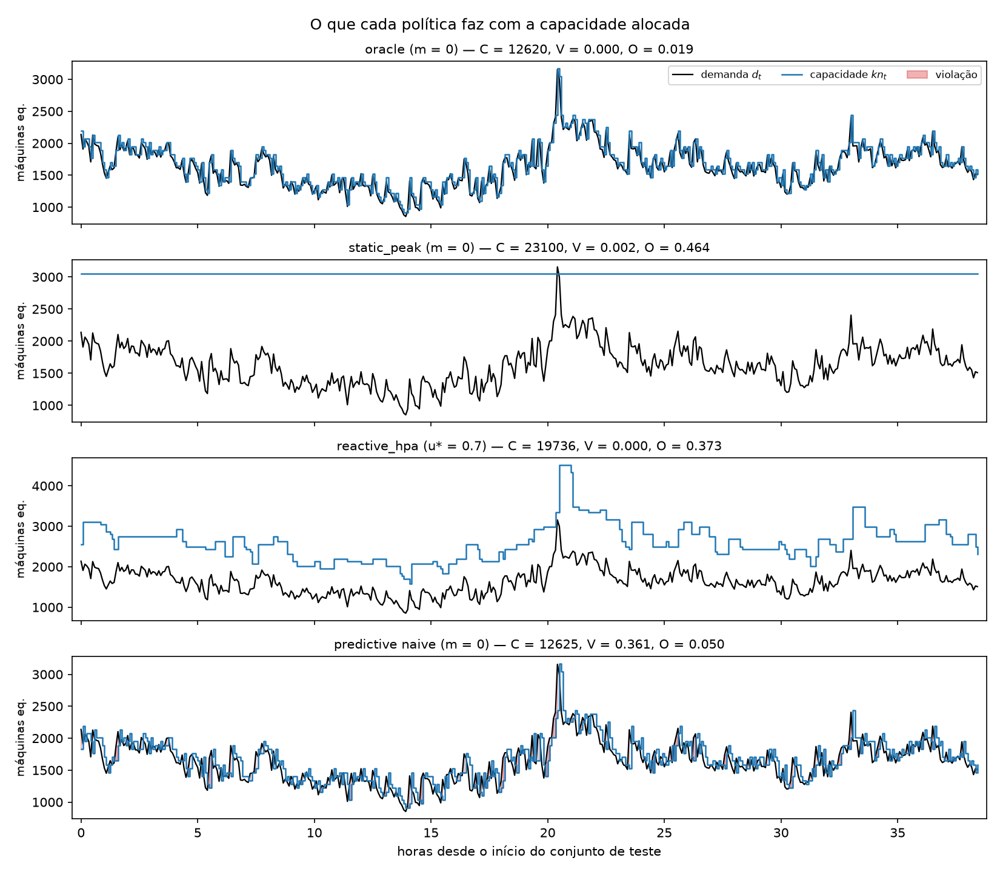

# Verificações de sanidade do simulador (G2)

Conjunto: **test** (462 intervalos de 300 s) · `L = 1` · `n_min = 1` · `c = 1.0`

Capacidade por instância: `k = max(d_train) / n_peak = 3047.2 / 50 = 60.944` máquinas equivalentes. Pico do teste: 3156.3 (1.036 do pico do treino).

## Tabela

| política | C | V | U | O | changes | n_mean | n_max | C_norm |
|---|---|---|---|---|---|---|---|---|
| oracle (m = 0) | 12620 | 0 | 0 | 0.0189 | 378 | 27.316 | 52 | 1 |
| static_peak (m = 0) | 23100 | 0.0022 | 0.0001 | 0.4641 | 0 | 50 | 50 | 1.8304 |
| reactive_hpa (u* = 0.5) | 27632 | 0 | 0 | 0.5519 | 117 | 59.8095 | 104 | 2.1895 |
| reactive_hpa (u* = 0.6) | 23038 | 0 | 0 | 0.4625 | 111 | 49.8658 | 87 | 1.8255 |
| reactive_hpa (u* = 0.7) | 19736 | 0 | 0 | 0.3726 | 108 | 42.7186 | 74 | 1.5639 |
| reactive_hpa (u* = 0.8) | 17323 | 0.0108 | 0.0006 | 0.2856 | 114 | 37.4957 | 65 | 1.3727 |
| reactive_hpa (u* = 0.9) | 15331 | 0.0303 | 0.0031 | 0.1949 | 102 | 33.184 | 58 | 1.2148 |
| reactive_hpa (u* = 0.95) | 14661 | 0.0736 | 0.0062 | 0.1607 | 109 | 31.7338 | 55 | 1.1617 |
| predictive naive (m = 0) | 12625 | 0.3615 | 0.0313 | 0.0499 | 378 | 27.3268 | 52 | 1.0004 |

## O que cada verificação mostra

- **Oráculo:** `V = 0.0000` e `U = 0.0000`, como exige a spec, com `C = 12620`. Ele é o **menor custo entre as políticas que não violam** (confirmado: as demais com `V = 0` custam de 19736 a 27632). Atenção ao que ele **não** é: nenhuma política ficou abaixo dele no custo.
- **static_peak:** ociosidade alta (`O = 0.464`) e custo 1.83× o do oráculo. `V = 0.0022 > 0` porque o pico do teste (3156) passa do pico do treino (3047): dimensionar pelo passado não protege contra um pico maior no futuro.
- **reactive_hpa:** decide em `τ` com `d[τ]`, mas a decisão só vale em `τ + L`, então só não viola enquanto a folga `1/u* − 1` cobrir a variação da demanda em um intervalo de 300 s. As violações crescem de forma monótona com `u*` (monotonicidade confirmada), de 0.0000 a 0.0736:

  | `u*` | V | C | C_norm | changes |
  |---|---|---|---|---|
  | 0.5 | 0.0000 | 27632 | 2.190 | 117 |
  | 0.6 | 0.0000 | 23038 | 1.826 | 111 |
  | 0.7 | 0.0000 | 19736 | 1.564 | 108 |
  | 0.8 | 0.0108 | 17323 | 1.373 | 114 |
  | 0.9 | 0.0303 | 15331 | 1.215 | 102 |
  | 0.95 | 0.0736 | 14661 | 1.162 | 109 |

- **predictive com `naive` (m = 0):** `V = 0.3615` e `C_norm = 1.000`. Comportamento próximo do reativo, o que faz sentido: os dois decidem olhando para a última observação. A diferença é que a política preditiva não tem tolerância nem janela de estabilização, então ela troca de tamanho muito mais vezes (378 alterações).

## Figura

A faixa vermelha marca os intervalos em que `d_t > k·n_t`. É o que o simulador conta em `V`.

## Simplificações do modelo

- Aumentos e reduções sofrem o **mesmo** atraso `L`; na prática, desligar é imediato.
- **Não há custo de troca**: `changes` é medido, mas não entra em `C`.
- Uma instância só, homogênea, de capacidade `k`; nada de tipos ou de posicionamento.
- A demanda é independente da alocação: violar não gera fila nem demanda represada.
